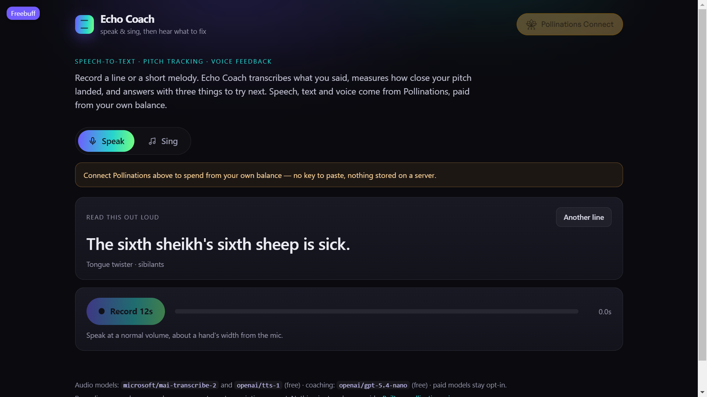

### App Name

Echo Coach

### App Description

Record a line or a five-note melody: it transcribes your speech, measures your pitch in cents, and answers with three coaching tips read aloud, all from Pollinations models.

### App URL

https://rekty.github.io/echo-coach/

### GitHub Repository URL

https://github.com/rekty/echo-coach

### App Category

video_audio

### Platform

web

### App Language

en

### Screenshot

### Quest

#20022
